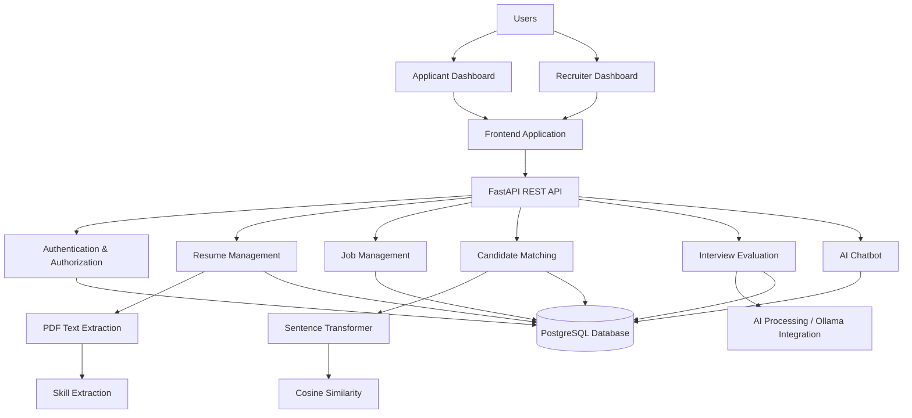

# 🤖 AI-Powered Recruitment Agent

### Smarter Screening. Better Matching. Intelligent Hiring.

An AI-powered recruitment platform that automates resume screening, candidate-job matching, ATS scoring, and interview evaluation using Artificial Intelligence and Machine Learning.

<p align="center">
  
</p>

<p align="center">
  
  
  
  
  
  
</p>

---

## 📌 Table of Contents

- [Overview](#-overview)
- [Problem Statement](#-problem-statement)
- [Project Objectives](#-project-objectives)
- [Key Features](#-key-features)
- [Technology Stack](#-technology-stack)
- [System Architecture](#-system-architecture)
- [Application Workflow](#-application-workflow)
- [AI and Machine Learning](#-ai-and-machine-learning)
- [Database Design](#-database-design)
- [Project Structure](#-project-structure)
- [Screenshots](#-screenshots)
- [Installation and Setup](#-installation-and-setup)
- [API Documentation](#-api-documentation)
- [Security](#-security)
- [Future Enhancements](#-future-enhancements)
- [Project Status](#-project-status)
- [Author](#-author)

---

## 📖 Overview

The **AI-Powered Recruitment Agent** is an intelligent recruitment management platform designed to simplify and automate the hiring process.

Traditional recruitment involves manually reviewing resumes, identifying candidate skills, comparing qualifications with job requirements, and evaluating interview performance.

This platform uses Artificial Intelligence and Machine Learning to assist recruiters in these activities.

It provides separate dashboards for recruiters and applicants.

Recruiters can publish job openings, review applicants, access resumes, analyze candidate matching results, and evaluate interview performance.

Applicants can register, upload resumes, explore job opportunities, and participate in the recruitment process.

The primary goal is to make recruitment faster, more organized, and data-driven.

---

## ❗ Problem Statement

Traditional recruitment processes face several challenges:

- Manual resume screening is time-consuming.
- Identifying relevant candidate skills requires effort.
- Comparing resumes with job descriptions can be inconsistent.
- Recruiters may receive large numbers of applications.
- Interview evaluation can be difficult to standardize.
- Managing applicant information across multiple recruitment stages is challenging.

The AI-Powered Recruitment Agent addresses these challenges through automated resume processing, semantic matching, ATS-style scoring, and AI-assisted interview evaluation.

---

## 🎯 Project Objectives

- Automate resume screening and text extraction.
- Identify technical skills from candidate resumes.
- Match resumes with job descriptions using semantic similarity.
- Generate ATS-style matching scores.
- Identify matched and missing skills.
- Provide separate recruiter and applicant dashboards.
- Allow recruiters to manage job listings.
- Enable recruiters to view and download applicant resumes.
- Generate AI-assisted interview questions.
- Evaluate applicant interview answers.
- Maintain interview evaluation history.
- Provide a foundation for production-ready recruitment automation.

---

## 🚀 Key Features

### 👤 Applicant Dashboard

- Secure applicant registration and login.
- Upload resumes in PDF format.
- Automatic resume text extraction.
- Technical skill identification.
- Explore available job listings.
- Resume-job matching.
- ATS-style resume scoring.
- View matching results and history.

### 🧑‍💼 Recruiter Dashboard

- Secure recruiter authentication.
- Create and manage job openings.
- Update and delete job listings.
- View applicant information.
- Review candidate matching results.
- Identify matched and missing skills.
- View and download applicant resumes.
- Evaluate candidates.

### 🧠 AI-Powered Resume Screening

- PDF resume processing.
- Resume text extraction.
- Automatic skill identification.
- Semantic resume-job similarity.
- Candidate matching percentage.
- Matched skills analysis.
- Missing skills identification.

### 📊 ATS Resume Scoring

The system compares resume content with job descriptions to provide an ATS-style matching score.

The matching results help recruiters understand how closely a candidate's qualifications align with job requirements.

### 🎤 AI Interview Evaluation

- AI-assisted interview question generation.
- Questions organized by categories.
- Expected answer points.
- Applicant answer evaluation.
- Structured evaluation results.
- Interview evaluation history.

### 💬 AI Chatbot

The project includes backend chatbot integration to support AI-assisted interaction within the recruitment platform.

---

## 🛠️ Technology Stack

| Category | Technologies |
|---|---|
| Programming Language | Python |
| Backend Framework | FastAPI |
| Frontend | HTML5, CSS3, JavaScript |
| Frontend Development | Vite |
| Database | PostgreSQL |
| ORM | SQLAlchemy |
| Data Validation | Pydantic |
| Authentication | JWT, HTTP Bearer |
| AI/ML Framework | Sentence Transformers |
| Embedding Model | all-MiniLM-L6-v2 |
| Similarity Algorithm | Cosine Similarity |
| Local AI Integration | Ollama |
| PDF Processing | PyPDF2 / PDF processing library |
| API Testing | Swagger UI |
| Version Control | Git and GitHub |

---

## 🏗️ System Architecture

The application follows a client-server architecture with separate frontend, backend, database, and AI processing components.

### Architecture Diagram



### Architecture Components

1. **Frontend Layer:** Provides applicant and recruiter interfaces.
2. **API Layer:** Handles HTTP requests through FastAPI.
3. **Authentication Layer:** Manages JWT authentication and user authorization.
4. **Business Logic Layer:** Processes resumes, jobs, matching, and evaluations.
5. **AI/ML Layer:** Performs semantic similarity and AI-assisted processing.
6. **Database Layer:** Stores users, resumes, jobs, matching results, and evaluation records.

---

## 🔄 Application Workflow


---

## 🧠 AI and Machine Learning

### 1. Resume Text Extraction

The system processes PDF resumes and extracts textual information for further analysis.

### 2. Skill Extraction

The application identifies technical skills such as:

- Python
- Java
- C++
- SQL
- PostgreSQL
- FastAPI
- Django
- Flask
- React
- JavaScript
- Machine Learning
- Deep Learning
- Pandas
- NumPy
- Scikit-learn
- TensorFlow
- PyTorch
- Docker
- Git
- AWS
- Azure

### 3. Semantic Resume Matching

The Sentence Transformer model `all-MiniLM-L6-v2` converts resume content and job descriptions into vector embeddings.

Cosine similarity is used to measure the semantic relationship between the two representations.

The results help identify candidates whose experience and skills are relevant to a particular job.

### 4. ATS Scoring

The platform provides matching scores and skill comparisons to assist recruiters during candidate screening.

### 5. Interview Evaluation

AI-assisted functionality supports interview question generation and evaluates applicant answers against expected answer points.

**Note:** AI-generated scores and evaluations are decision-support tools and should not independently determine hiring decisions.

---

## 🗄️ Database Design

The application uses PostgreSQL as its relational database.

Core database entities include:

| Table / Entity | Purpose |
|---|---|
| Users | Stores applicant and recruiter accounts |
| Resumes | Stores uploaded resume information |
| Jobs | Stores recruiter job listings |
| Match Results | Stores candidate-job matching information |
| Interview Evaluations | Stores interview assessment information |
| Evaluation History | Supports reviewing previous evaluations |

SQLAlchemy is used for database interaction.

---

## 📂 Project Structure

```text
AI-Powered-Recruitment-Agent/
│
├── backend/
│   ├── app/
│   │   ├── models/
│   │   ├── routes/
│   │   ├── schemas/
│   │   ├── services/
│   │   ├── dependencies.py
│   │   ├── database.py
│   │   └── main.py
│   │
│   ├── migrations/
│   └── requirements.txt
│
├── frontend/
│   ├── index.html
│   ├── home.html
│   ├── login.html
│   ├── register.html
│   ├── applicant-dashboard.html
│   ├── recruiter-dashboard.html
│   ├── assets/
│   └── package.json
│
├── docs/
│   └── images/
│       ├── project-banner.png
│       ├── home-page.png
│       ├── login-page.png
│       ├── applicant-dashboard.png
│       ├── recruiter-dashboard.png
│       ├── resume-matching.png
│       └── interview-evaluation.png
│
├── README.md
├── .gitignore
└── AI_Powered_Recruitment_Agent_Project_Report.docx
```

*The structure above illustrates the main project components. Adjust filenames to match your actual repository.*

---

## 🖼️ Screenshots

Screenshots demonstrate the application's user interface and functionality.

### 1. Home Page

<p align="center">
  
</p>

### 2. Login Page

<p align="center">
  
</p>

### 3. Applicant Dashboard

<p align="center">
  
</p>

### 4. Recruiter Dashboard

<p align="center">
  
</p>

### 5. Resume Matching Results

<p align="center">
  
</p>

### 6. Interview Evaluation

<p align="center">
  
</p>

> Replace these image placeholders with actual screenshots of your application.

---

## ⚙️ Installation and Setup

### Prerequisites

Install the following software:

- Python 3.11 or later
- PostgreSQL
- Node.js and npm
- Git
- Ollama (if using local AI model integration)

### 1. Clone the Repository

```powershell
git clone https://github.com/Srinivas-Dasathwar/AI-Powered-Recruitment-Agent.git

cd AI-Powered-Recruitment-Agent
```

### 2. Create a Python Virtual Environment

```powershell
python -m venv venv
```

Activate it:

```powershell
.\venv\Scripts\Activate.ps1
```

### 3. Install Backend Dependencies

```powershell
pip install -r backend/requirements.txt
```

### 4. Configure Environment Variables

Create a `.env` file in the project root or the location expected by your backend configuration.

Example configuration:

```env
DATABASE_URL=your_postgresql_connection_string
SECRET_KEY=your_secure_secret_key
ALGORITHM=HS256
ACCESS_TOKEN_EXPIRE_MINUTES=60
```

Configure additional AI-related environment variables if required by your implementation.

**Important:** Never upload your `.env` file or API keys to GitHub.

### 5. Configure PostgreSQL

Create the application database in PostgreSQL.

Configure the database connection string in your environment variables.

Run the project's database migrations using its configured migration workflow.

### 6. Start the Backend

From the project root:

```powershell
uvicorn app.main:app --app-dir backend --reload
```

If your application uses a different import configuration, adjust this command accordingly.

Backend:

```text
http://127.0.0.1:8000
```

### 7. Access API Documentation

Open:

```text
http://127.0.0.1:8000/docs
```

FastAPI Swagger UI provides an interface for exploring and testing available endpoints.

### 8. Start the Frontend

Open a separate PowerShell terminal, navigate to the frontend directory, and run the development command configured in `frontend/package.json`.

For a Vite application:

```powershell
npm install
npm run dev
```

Open the local URL displayed by Vite.

---

## 🔌 API Documentation

The backend exposes REST APIs for different application modules.

| Module | Purpose |
|---|---|
| Authentication | Registration, login, and user authentication |
| Resume | Upload, list, process, and manage resumes |
| Jobs | Create, list, update, and delete jobs |
| Matching | Compare resumes with job descriptions |
| ATS Scoring | Generate resume matching scores |
| Interview | Generate questions and evaluate answers |
| Evaluation History | Review previous evaluations |
| Chatbot | AI-assisted interaction |

The complete available API documentation can be accessed through:

**Swagger UI:** `http://127.0.0.1:8000/docs`

---

## 🔐 Security

The application incorporates security-related mechanisms:

- JWT-based authentication.
- Password hashing.
- HTTP Bearer token authentication.
- Role-based access control.
- Protected backend endpoints.
- User-specific resume access checks.
- PDF upload validation.
- Environment-based configuration.

Further security auditing and production hardening are ongoing.

---

## 🔮 Future Enhancements

- Advanced AI-based resume parsing.
- Automated interview scheduling.
- Email notifications.
- Advanced recruiter analytics.
- Candidate recommendation system.
- Resume improvement suggestions.
- Improved AI chatbot interface.
- Cloud deployment.
- Scalable infrastructure.
- Comprehensive automated testing.
- Audit logging and monitoring.

---

## 📊 Project Status

**Current Stage: Advanced Development / Production Readiness**

Major recruitment modules have been implemented, including authentication, dashboards, resume processing, job management, semantic matching, ATS scoring, and interview evaluation.

Additional testing, security validation, deployment configuration, and production hardening remain ongoing.

---

## 👨‍💻 Author

**Srinivas Dasathwar**

GitHub: [@Srinivas-Dasathwar](https://github.com/Srinivas-Dasathwar)

Project Repository:

[AI-Powered Recruitment Agent](https://github.com/Srinivas-Dasathwar/AI-Powered-Recruitment-Agent)

---

## 📄 Project Documentation

For a detailed explanation of the project, architecture, modules, technologies, workflow, and implementation, refer to:

**AI_Powered_Recruitment_Agent_Project_Report.docx**

---

## ⭐ Support

If you find this project interesting, consider giving the repository a ⭐ on GitHub!

<p align="center">
  <b>AI-Powered Recruitment Agent</b><br>
  Smarter Screening. Better Matching. Intelligent Hiring.
</p>
