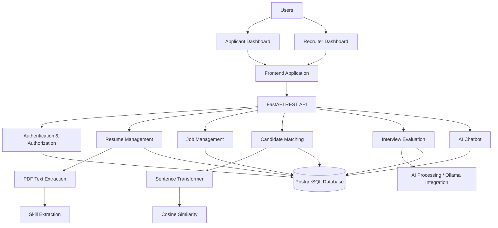
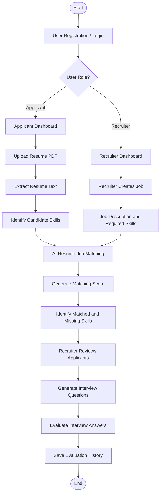

# 🤖 AI-Powered Recruitment Agent

### Smarter Screening. Better Matching. Intelligent Hiring.

An AI-powered recruitment platform for automated resume screening, candidate matching, ATS scoring, and interview evaluation using Artificial Intelligence and Machine Learning.

<p align="center">
  
  
  
  
  
  
</p>

---

## 📌 Table of Contents

- [Overview](#-overview)
- [Problem Statement](#-problem-statement)
- [Objectives](#-objectives)
- [Key Features](#-key-features)
- [Technology Stack](#-technology-stack)
- [System Architecture](#-system-architecture)
- [Application Workflow](#-application-workflow)
- [AI and Machine Learning](#-ai-and-machine-learning)
- [Database Design](#-database-design)
- [Project Structure](#-project-structure)
- [Installation and Setup](#-installation-and-setup)
- [API Documentation](#-api-documentation)
- [Security](#-security)
- [Project Status](#-project-status)
- [Future Enhancements](#-future-enhancements)
- [Author](#-author)

---

## 📖 Overview

The **AI-Powered Recruitment Agent** is an intelligent recruitment management platform developed to simplify and automate the hiring process.

The application uses Artificial Intelligence and Machine Learning to assist recruiters in reviewing resumes, identifying candidate skills, matching applicants with job requirements, generating ATS-style scores, and evaluating interview answers.

The platform provides two separate dashboards:

- **Applicant Dashboard:** Allows applicants to register, upload resumes, explore jobs, and access resume matching functionality.
- **Recruiter Dashboard:** Allows recruiters to manage job openings, review applicants, access resumes, analyze matching results, and evaluate candidates.

The main goal is to make recruitment more efficient, organized, and intelligent.

---

## ❗ Problem Statement

Traditional recruitment processes involve manually reviewing resumes, comparing candidate qualifications, identifying relevant skills, and evaluating interview performance.

These activities can be time-consuming and difficult to manage when organizations receive large numbers of applications.

The AI-Powered Recruitment Agent addresses these challenges by providing automated resume processing, semantic candidate matching, ATS scoring, and AI-assisted interview evaluation.

---

## 🎯 Objectives

- Automate resume screening and text extraction.
- Extract technical skills from candidate resumes.
- Match resumes with job descriptions.
- Generate ATS-style matching scores.
- Identify matched and missing skills.
- Provide separate recruiter and applicant dashboards.
- Allow recruiters to manage job listings.
- Enable recruiters to view and download applicant resumes.
- Generate AI-assisted interview questions.
- Evaluate applicant interview answers.
- Maintain interview evaluation history.
- Provide a centralized recruitment management platform.

---

## 🚀 Key Features

### 👤 Applicant Dashboard

- Applicant registration and login.
- Upload resumes in PDF format.
- Automatic resume text extraction.
- Technical skill identification.
- View available job listings.
- Resume-job matching.
- ATS-style resume scoring.
- View matching results and history.

### 🧑‍💼 Recruiter Dashboard

- Recruiter registration and login.
- Create and manage job openings.
- Update and delete job listings.
- View applicant information.
- Review candidate matching results.
- Identify matched and missing skills.
- View and download applicant resumes.
- Evaluate candidates.

### 🧠 AI-Powered Resume Screening

- PDF resume processing.
- Resume text extraction.
- Automatic skill identification.
- Semantic resume-job similarity.
- Candidate matching percentage.
- Matched skills analysis.
- Missing skills identification.

### 📊 ATS Resume Scoring

The system compares resume content with job descriptions to provide an ATS-style matching score.

Recruiters can use the matching percentage and skill analysis to understand candidate suitability.

### 🎤 AI Interview Evaluation

- AI-assisted interview question generation.
- Interview questions organized by categories.
- Expected answer points.
- Applicant answer evaluation.
- Structured evaluation results.
- Interview evaluation history.

### 💬 AI Chatbot

The project includes chatbot backend integration to support AI-assisted interaction within the recruitment platform.

---

## 🛠️ Technology Stack

| Category | Technologies |
|---|---|
| Programming Language | Python |
| Backend Framework | FastAPI |
| Frontend | HTML5, CSS3, JavaScript |
| Frontend Development | Vite |
| Database | PostgreSQL |
| ORM | SQLAlchemy |
| Data Validation | Pydantic |
| Authentication | JWT, HTTP Bearer |
| AI/ML | Sentence Transformers |
| Embedding Model | all-MiniLM-L6-v2 |
| Similarity Algorithm | Cosine Similarity |
| Local AI Integration | Ollama |
| PDF Processing | PyPDF2 / PDF processing library |
| API Testing | Swagger UI |
| Version Control | Git and GitHub |

---

## 🏗️ System Architecture

The application follows a client-server architecture with separate frontend, backend, database, and AI processing components.

### Architecture Diagram



### Architecture Components

1. **Frontend Layer:** Applicant and recruiter interfaces.
2. **API Layer:** Handles HTTP requests through FastAPI.
3. **Authentication Layer:** Manages JWT authentication and authorization.
4. **Business Logic Layer:** Processes resumes, jobs, matching, and evaluations.
5. **AI/ML Layer:** Performs semantic similarity and AI-assisted processing.
6. **Database Layer:** Stores users, resumes, jobs, matching results, and evaluation records.

---

## 🔄 Application Workflow



---

## 🧠 AI and Machine Learning

### 1. Resume Text Extraction

The system processes PDF resumes and extracts textual information for further analysis.

### 2. Skill Extraction

The application identifies technical skills, including:

- Python, Java, C++
- SQL, MySQL, PostgreSQL
- FastAPI, Django, Flask
- React, JavaScript, HTML, CSS
- Machine Learning and Deep Learning
- Pandas, NumPy, Scikit-learn
- TensorFlow and PyTorch
- Docker, Git, GitHub
- AWS, Azure, Power BI

### 3. Semantic Resume Matching

The Sentence Transformer model `all-MiniLM-L6-v2` converts resume content and job descriptions into vector embeddings.

Cosine similarity measures the semantic relationship between the two representations.

The results help identify candidates whose experience and skills are relevant to a particular job.

### 4. ATS Scoring

The platform provides matching scores and skill comparisons to assist recruiters during candidate screening.

### 5. Interview Evaluation

AI-assisted functionality supports interview question generation and evaluates applicant answers against expected answer points.

**Note:** AI-generated scores and evaluations are decision-support tools and should not independently determine hiring decisions.

---

## 🗄️ Database Design

The application uses PostgreSQL as its relational database.

Core database entities include:

| Table / Entity | Purpose |
|---|---|
| Users | Stores applicant and recruiter accounts |
| Resumes | Stores uploaded resume information |
| Jobs | Stores recruiter job listings |
| Match Results | Stores candidate-job matching information |
| Interview Evaluations | Stores interview assessment information |
| Evaluation History | Supports reviewing previous evaluations |

SQLAlchemy is used for database interaction.

---

## 📂 Project Structure

```text
AI-Powered-Recruitment-Agent/
│
├── backend/
│   ├── app/
│   │   ├── models/
│   │   ├── routes/
│   │   ├── schemas/
│   │   ├── services/
│   │   ├── dependencies.py
│   │   ├── database.py
│   │   └── main.py
│   │
│   ├── migrations/
│   └── requirements.txt
│
├── frontend/
│   ├── index.html
│   ├── home.html
│   ├── login.html
│   ├── register.html
│   ├── applicant-dashboard.html
│   ├── recruiter-dashboard.html
│   ├── assets/
│   └── package.json
│
├── README.md
├── .gitignore
└── AI_Powered_Recruitment_Agent_Project_Report.docx
```

*This is an illustrative structure; actual filenames may vary.*

---

## ⚙️ Installation and Setup

### Prerequisites

- Python 3.11 or later
- PostgreSQL
- Node.js and npm
- Git
- Ollama, if using local AI model integration

### 1. Clone the Repository

```powershell
git clone https://github.com/Srinivas-Dasathwar/AI-Powered-Recruitment-Agent.git

cd AI-Powered-Recruitment-Agent
```

### 2. Create a Virtual Environment

```powershell
python -m venv venv
```

Activate it:

```powershell
.\venv\Scripts\Activate.ps1
```

### 3. Install Backend Dependencies

```powershell
pip install -r backend/requirements.txt
```

### 4. Configure Environment Variables

Create a `.env` file in the location expected by the backend configuration.

Example:

```env
DATABASE_URL=your_postgresql_connection_string
SECRET_KEY=your_secure_secret_key
ALGORITHM=HS256
ACCESS_TOKEN_EXPIRE_MINUTES=60
```

Configure any additional AI-related environment variables required by your implementation.

**Important:** Never upload `.env` files or API keys to GitHub.

### 5. Configure PostgreSQL

Create the application database in PostgreSQL and configure the database connection string.

Run database migrations using the project's configured migration workflow.

### 6. Start the Backend

From the project root:

```powershell
uvicorn app.main:app --app-dir backend --reload
```

Backend URL:

```text
http://127.0.0.1:8000
```

### 7. Start the Frontend

Open a separate terminal and run:

```powershell
cd frontend
npm install
npm run dev
```

Open the local URL displayed by Vite.

---

## 🔌 API Documentation

The backend provides REST APIs for the following modules:

| Module | Purpose |
|---|---|
| Authentication | Registration, login, and user authentication |
| Resume | Upload, list, process, and manage resumes |
| Jobs | Create, list, update, and delete jobs |
| Matching | Compare resumes with job descriptions |
| ATS Scoring | Generate resume matching scores |
| Interview | Generate questions and evaluate answers |
| Evaluation History | Review previous evaluations |
| Chatbot | AI-assisted interaction |

Access interactive API documentation through FastAPI Swagger UI:

**http://127.0.0.1:8000/docs**

---

## 🔐 Security

The application incorporates:

- JWT-based authentication.
- Password hashing.
- HTTP Bearer token authentication.
- Role-based access control.
- Protected backend endpoints.
- User-specific resume access checks.
- PDF upload validation.
- Environment-based configuration.

---

## 📊 Project Status

<p align="center">
  
</p>

**Status: Developed**

The AI-Powered Recruitment Agent has been developed with its major recruitment and AI-assisted modules.

Implemented functionality includes:

- User registration and authentication.
- Applicant and recruiter dashboards.
- Resume uploading and PDF text extraction.
- Technical skill extraction.
- Job creation and management.
- AI-powered resume-job matching.
- ATS-style matching scores.
- Matched and missing skills identification.
- Applicant resume access.
- Interview question generation.
- Interview answer evaluation.
- Evaluation history.
- AI chatbot backend integration.
- PostgreSQL database integration.

---

## 🔮 Future Enhancements

- Advanced AI-based resume parsing.
- Automated interview scheduling.
- Email notifications.
- Advanced recruiter analytics.
- Candidate recommendation system.
- Resume improvement suggestions.
- Enhanced chatbot interface.
- Cloud deployment and scalability.
- Advanced monitoring and reporting.

---

## 👨‍💻 Author

**Srinivas Dasathwar**

GitHub: [@Srinivas-Dasathwar](https://github.com/Srinivas-Dasathwar)

Project Repository:

[AI-Powered Recruitment Agent](https://github.com/Srinivas-Dasathwar/AI-Powered-Recruitment-Agent)

---

## 📄 Project Documentation

For detailed information about the project, refer to:

**AI_Powered_Recruitment_Agent_Project_Report.docx**

---

## ⭐ Support

If you find this project interesting, consider giving the repository a ⭐ on GitHub!

<p align="center">
  <b>AI-Powered Recruitment Agent</b><br>
  Smarter Screening. Better Matching. Intelligent Hiring.
</p>
